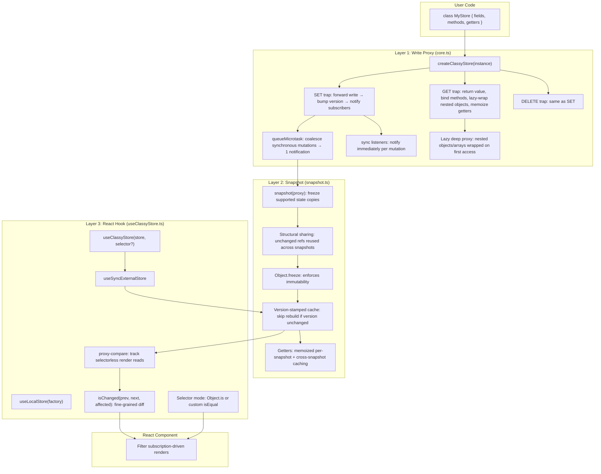
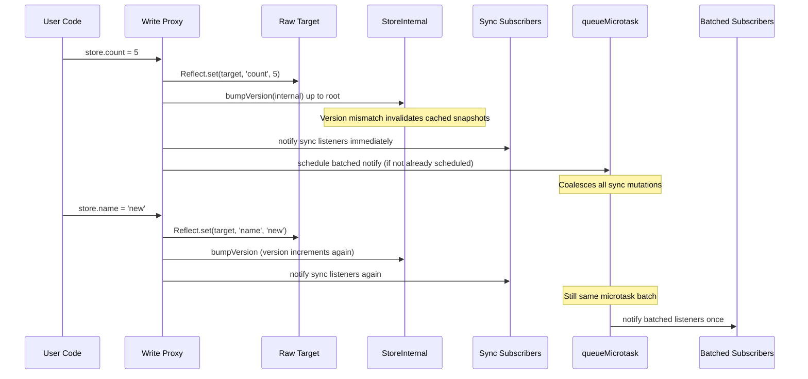
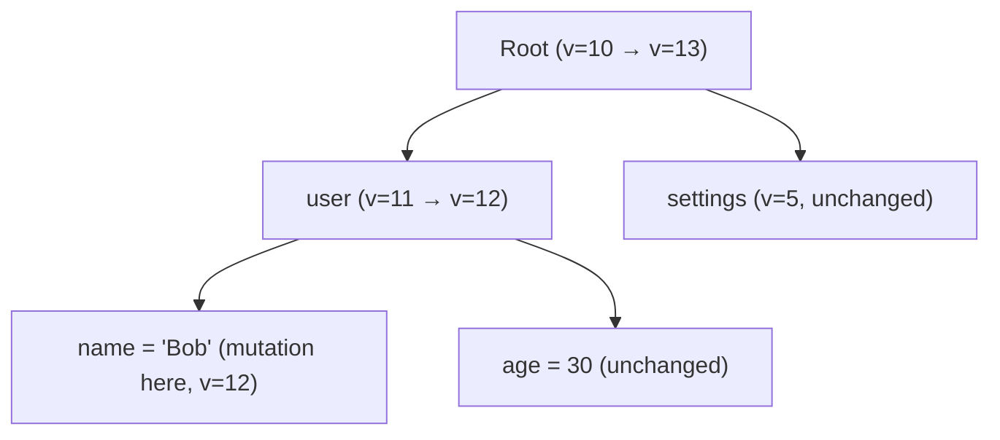
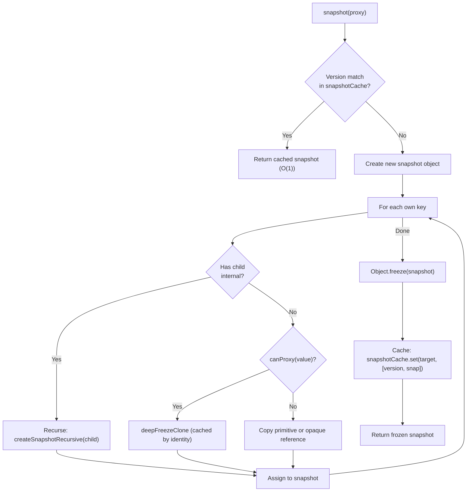
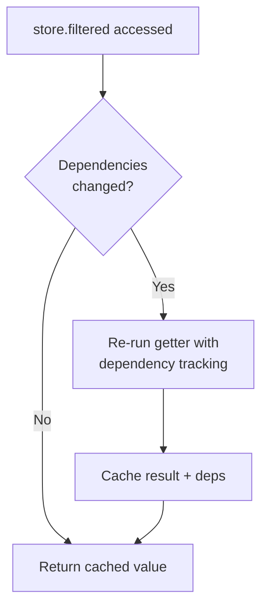
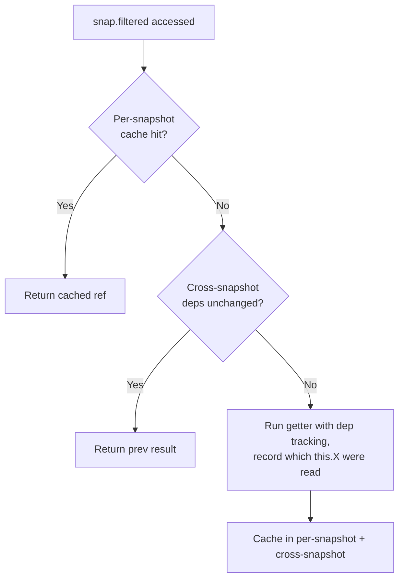
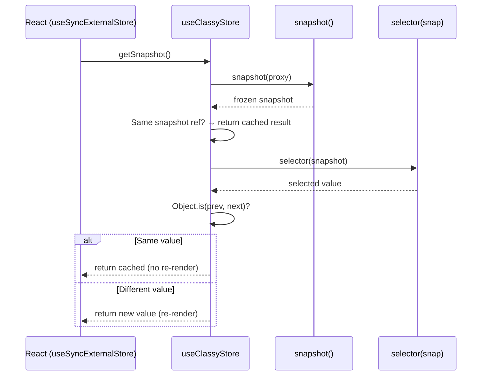
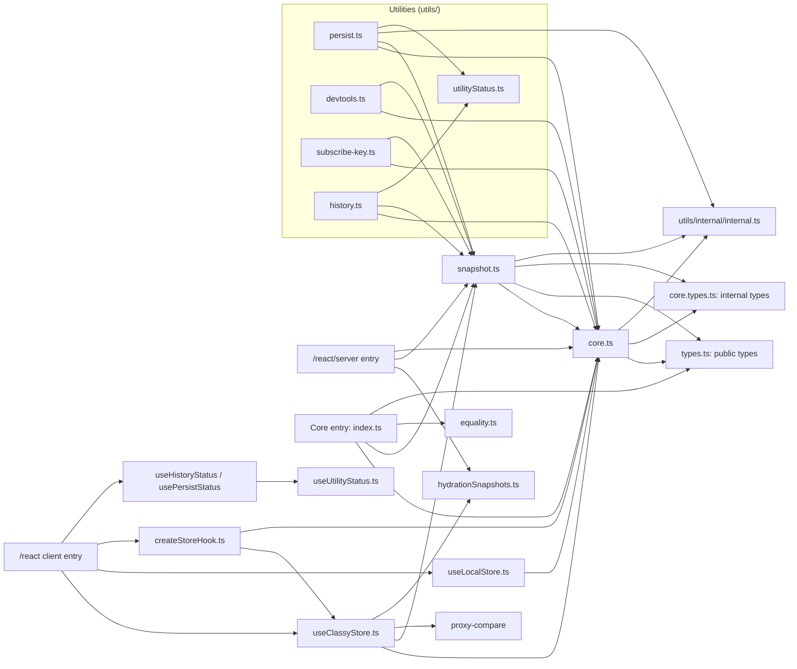

# Classy Store — Architecture

Internal design documentation for contributors and maintainers.

## Three-Layer Architecture

The library is organized into three distinct layers, each with a single responsibility:



## File Map

The library lives in `packages/classy-store`. Public entry points expose the API;
implementation files and types live with the feature that owns them.

```text
packages/classy-store/
├── src/
│   ├── index.ts                         # Core public entry; no React dependency
│   ├── types.ts                         # Public Snapshot<T> and SubscribeOptions
│   ├── core/
│   │   ├── core.ts                      # Write proxies, subscriptions, computed getters
│   │   ├── core.types.ts                # Internal dependency and store bookkeeping types
│   │   ├── core.computed.test.ts        # Write-proxy getter memoization
│   │   └── core.ownership.test.ts       # Child ownership and subscription cleanup
│   ├── snapshot/
│   │   ├── snapshot.ts                  # Immutable snapshots and structural sharing
│   │   └── snapshot.computed.test.ts    # Snapshot getter memoization
│   ├── collections/
│   │   ├── index.ts                     # Public collections entry
│   │   └── collections.ts               # ReactiveMap and ReactiveSet
│   ├── frameworks/
│   │   └── react/
│   │       ├── react.ts                 # Public client entry; exports hooks and factory
│   │       ├── server.ts                # Server-safe prepareStoreForHydration entry
│   │       ├── hooks/
│   │       │   ├── useClassyStore/      # Selector and auto-tracked subscriptions; hook types
│   │       │   ├── useLocalStore/       # Component-scoped store creation
│   │       │   ├── useHistoryStatus/    # Public history status hook
│   │       │   ├── usePersistStatus/    # Public persistence status hook
│   │       │   └── useUtilityStatus/    # Internal shared status subscription hook
│   │       ├── utils/
│   │       │   ├── createStoreHook/     # Bound store hook factory
│   │       │   ├── hydrationSnapshots/  # Shared captured snapshots, held by weak keys
│   │       │   ├── snapshotTargetCache/ # Shared tracking targets
│   │       │   └── trackingReadMap/     # Render-local and committed dependency reads
│   │       ├── testHelpers/            # React fixtures
│   │       └── react.*.test.tsx         # Integration tests grouped by behavior
│   └── utils/
│       ├── index.ts                     # Public utility functions and types
│       ├── persist/
│       │   ├── persist.ts               # Storage queue, hydration, transforms, tab sync
│       │   ├── persist.types.ts         # Public persistence options, status, and handle
│       │   └── persist.*.test.ts        # API, concurrency, and error regressions
│       ├── history/                     # Undo/redo and status
│       ├── devtools/                    # Redux DevTools integration
│       ├── subscribe-key/               # Single-property subscriptions
│       ├── equality/                    # shallowEqual
│       ├── utilityStatus/               # Internal framework-neutral status source
│       ├── cloneSnapshot/               # Internal snapshot cloning
│       └── internal/                    # Proxy and property helpers
├── tests/
│   ├── browser/                         # Real input, hydration, and persistence tests
│   ├── compatibility/                   # Packed-library React version matrix
│   ├── compiler/                        # Compiled consumer fixtures and regressions
│   ├── scoping/                         # Provider isolation, lifecycle, and SSR
│   ├── next/                            # Packed Next.js boundaries and navigation
│   ├── memory/                          # Heap snapshots and retention checks
│   └── performance/                     # Form and list benchmarks
├── tsdown.config.ts                     # Published entry points and bundle settings
└── bunfig.toml                          # happy-dom setup for source tests
```

Tests for core behavior stay beside their implementation. React integration tests
exercise the public client entry, including computed getter behavior. Consumer
fixtures under `tests/` verify the packed library and framework build boundaries.
The other framework adapters remain under `src/frameworks/`.

Runnable examples live in `examples/react` and `examples/nextjs` at the repository
root. This guide and the utility architecture guides live in `website/docs`.

## Layer 1: Write Proxy (`core.ts`)

### Overview

The `createClassyStore()` function wraps a class instance in an ES6 Proxy. Assignments and deletions through that proxy, including array operations and supported nested state, are intercepted. Raw-object writes and descriptor changes bypass these traps. Subscribers are batched by default into one microtask notification, while React, Vue, Svelte, Solid, and Angular use the synchronous path.

### Data Flow: Mutation → Notification



### Internal State Storage

All internal bookkeeping is stored in a `WeakMap<proxy, StoreInternal>`:

```typescript
type StoreInternal = {
  target: object;                           // Raw class instance
  version: number;                          // Monotonically increasing
  batchedListeners: Set<() => void>;        // Subscribers notified once per microtask
  syncListeners: Set<() => void>;           // Subscribers notified immediately per mutation
  childProxies: Map<string|symbol, object>; // Cached child proxies
  childInternals: Map<string|symbol, StoreInternal>;
  parent: StoreInternal | null;             // For version propagation
  notifyScheduled: boolean;                 // Batch dedup flag
  computedCache: Map<string|symbol, ComputedEntry>; // Memoized getter cache
};
```

### Proxy Traps

**SET trap:**
1. Compare old and new values with `Object.is` — noop if equal
2. Forward the write to the raw target via `Reflect.set`
3. After a successful write, detach the old child proxy and clear the bound-method cache. Array length truncation detaches removed children, including partial truncation when a non-configurable index rejects the requested length. An otherwise failed write preserves the old connection.
4. Bump version for this node and all ancestors
5. Notify sync listeners immediately, then schedule batched listeners via `queueMicrotask` (deduped)

**GET trap (priority order):**
1. **Memoized getter detection** — walk prototype chain with `Object.getOwnPropertyDescriptor`. If a getter is found, call `evaluateComputed()` which checks dependency validity and returns the cached result or re-evaluates with dependency tracking.
2. **Method binding** — if value is a function, bind to proxy so `this.count++` in methods goes through the SET trap. Bound methods are cached.
3. **Nested state** — if `canProxy()` accepts it (plain object, array, or a class such as the library's reactive collections using the internal opt-in), lazily wrap it in a cached child proxy. Record a dependency if a getter is currently being tracked.
4. **Primitives and opaque values** — return as-is and record a value dependency when a getter is being tracked.

**DELETE trap:** Attempt `Reflect.deleteProperty` first. On success, detach the child, clear the bound-method cache, bump versions, and notify. A failed deletion preserves the connection.

### Batching via `queueMicrotask`

Array operations like `push()` trigger multiple SET traps (element + length). For ordinary listeners, a dirty flag + `queueMicrotask` coalesces these mutations into one notification:

```
store.items.push('a')
  → SET trap for index 0 → scheduleNotify (flags, queues microtask)
  → SET trap for length  → already updated by the index write, Object.is skips it
  → microtask fires → notifies listeners ONCE
```

Subscribers opt into immediate timing with `{sync: true}`. Sync subscribers run after version propagation and before the batched microtask. They are intentionally not deduped: two writes mean two sync notifications. Every React hook uses this timing so `useSyncExternalStore` observes the new value during the input event, preserving controlled-input caret position. Selectors can run after each write; React batches rendering within event handlers.

The Svelte adapter also uses synchronous notifications to satisfy the readable
store contract. It subscribes before delivering the initial snapshot so mutations
inside that first callback are observed, and removes the subscription if the
initial callback throws. Normal unsubscription stops delivery even if another
subscriber removes it during an in-progress notification.

The Vue adapter updates its shallow ref synchronously too. Vue handles render
batching, and `nextTick()` then waits for the queued DOM update. The hook requires
an active component or effect scope to own cleanup, and ignores notifications if
that scope has been disposed during an in-progress notification.

The Solid 2 adapter forwards synchronous notifications into an internal signal
with `ownedWrite: true`, allowing external store notifications while an owner is
active. Solid schedules its own reactive work; the adapter never calls `flush()`.
A live owner is required before subscribing. Owner cleanup marks delivery inactive
before removing the listener, and callbacks also check disposal during notification.
The adapter targets the exact `2.0.0-rc.18` prerelease; see the [Solid guide](./SOLID.md).

The Angular adapter also uses synchronous notifications, keeping its readonly
snapshot signal and dependent computed reads current. Angular schedules its own
effects and rendering, including zoneless `OnPush` views. `DestroyRef` owns the
subscription; an inactive/destroyed guard ignores callbacks during teardown.
It supports stable Angular 22 releases (`^22.0.0`); see the [Angular guide](./ANGULAR.md).

### Version Propagation

When a nested property mutates, versions bump from the mutated node up to the root:



This enables structural sharing: when the snapshot layer sees that `settings` has the same version, it returns the cached snapshot reference.

## Layer 2: Immutable Snapshots (`snapshot.ts`)

### Overview

`snapshot(proxy)` freezes copies of the root state and supported nested objects, preserving class prototypes. Unchanged sub-trees reuse previous snapshot references. Opaque leaves retain their references, and newly allocated getter results are not automatically frozen; see [snapshot semantics](./TUTORIAL.md#snapshots).

### Snapshot Creation Flow



### Two Cache Strategies

1. **Tracked sub-trees** (`snapshotCache` — `WeakMap<rawTarget, [version, frozenSnap]>`):
   Objects that have been accessed through the proxy have a `StoreInternal` with version tracking. The snapshot recurses into them and uses version-stamped caching for structural sharing.

2. **Untracked sub-trees** (`untrackedCache` — `WeakMap<rawObject, frozenClone>`):
   Supported objects not yet accessed through the proxy are cloned and frozen, with a cache keyed by raw identity. Correctness assumes callers mutate through the store proxy. Promotion to a versioned child removes the obsolete untracked cache entry. Raw-object mutation bypasses invalidation and is unsupported.

### Structural Sharing Example

```
Snapshot v1:                    Snapshot v2 (after user.name = 'Bob'):
┌──────────┐                    ┌──────────┐
│ root     │                    │ root     │ (new object)
│ user ────┼──→ {name:'Alice'}  │ user ────┼──→ {name:'Bob'} (new)
│ settings─┼──→ {theme:'dark'}  │ settings─┼──→ {theme:'dark'} (SAME ref ===)
└──────────┘                    └──────────┘
```

`snap2.settings === snap1.settings` because the `settings` sub-tree's version didn't change → cache hit → same reference.

### Getter Evaluation (Memoized)

Snapshots preserve the prototype chain and install lazy-memoizing getters on each snapshot object. Getter results are cached at two levels:

1. **Per-snapshot cache** — repeated access to the same getter on the same snapshot returns the identical reference.
2. **Cross-snapshot cache** — if the properties the getter reads are structurally the same across snapshots (via reference equality from structural sharing), the previous result is returned.

```typescript
class Store {
  count = 5;
  get doubled() { return this.count * 2; }
}

const snap = snapshot(createClassyStore(new Store()));
snap.doubled; // 10 — computed once, cached
snap.doubled; // 10 — same reference (per-snapshot cache hit)
```

## Computed Getter Memoization

Class getters are automatically memoized at two layers — the write proxy and the snapshot — without any user-facing API changes. This is analogous to MobX's `@computed`, but implemented transparently via Proxy.

### Write Proxy Memoization (`core.ts`)

When a getter is accessed on the write proxy, `evaluateComputed()` runs the getter with dependency tracking. A module-level tracker stack records which properties the getter reads on `this`:



**Dependency types:**
- **Sub-tree dep** (`kind: 'version'`): the getter read a nested object/array. Validated by comparing `internal.version` — O(1) per dep.
- **Value dep** (`kind: 'value'`): a primitive or opaque value read. Validation checks property existence and `Object.is(target[prop], recordedValue)`.
- **Computed dep** (`kind: 'computed'`): a read of another computed getter. Validation checks that getter's cached result and dependencies recursively.

**Nested getter support:** when getter A reads getter B, A records a computed dependency on B. B tracks its own reads in a separate frame. Dependency validation follows those cached dependencies without executing a raw getter just to check whether it changed. Recursive evaluation of the same getter is detected and throws.

### Snapshot Memoization (`snapshot.ts`)

Getters are cached per snapshot and can reuse results **across** snapshots when dependencies haven't changed. New objects returned by getters are not automatically frozen; callers must treat them as readonly. Getters must be pure and derive their values from explicit store property reads, not time or external mutable state:



**Cross-snapshot mechanism:**
1. First evaluation: a lightweight tracking Proxy records which `this` properties the getter reads and their values.
2. On subsequent snapshots: for each recorded property, check `Object.is(currentSnap[prop], previousValue)`.
3. Structural sharing guarantees that unchanged sub-trees have the same reference — so if `this.todos` hasn't changed, the reference comparison passes and the cached result is returned.
4. For getters reading other getters (e.g., `get filteredCount() { return this.filtered.length; }`): the inner getter is itself memoized, so it returns a stable reference, which the outer getter's dep check recognizes as unchanged.

**Impact on `useClassyStore`:** The existing hook benefits automatically — no changes needed:
- **Selector mode:** `useClassyStore(store, (state) => state.filtered)` gets a stable reference from the memoized snapshot getter. `Object.is` correctly detects "no change" without `shallowEqual`.
- **Auto-tracked mode:** `proxy-compare`'s `isChanged` gets stable references from snapshot getters, reducing false positives.

## Layer 3: React Hook (`hooks/useClassyStore/useClassyStore.ts`)

### Overview

`useClassyStore` uses `useSyncExternalStore` for tear-free React integration. React subscriptions always notify synchronously, allowing controlled inputs to observe updates during their event. The React API has no timing option; ordinary core subscriptions remain batched. It supports two modes:

### Server rendering and hydration

`prepareStoreForHydration(store)` captures an immutable snapshot in a WeakMap keyed by the exact store proxy. It returns the same mutable proxy and preserves the first capture on repeated calls. Capturing is explicit at bootstrap, before rendering or persistence, because a delayed Suspense boundary may not call its hook until after the live store changes.

Prepared stores supply that snapshot through `getServerSnapshot`; ordinary `getSnapshot` still reads live state. Each selector has separate server and live caches. When React reads the hydration result, it can seed the live cache with that result so unchanged inputs and equal selections retain their references without overwriting committed selections during rendering. Client-only mounts never evaluate the server selector.

The capture stays available for the store's lifetime, including later boundaries or roots. It is never cleared when the first consumer mounts. Unprepared stores keep the existing current-snapshot behavior. Core mutation timing, ordinary subscriptions, and `snapshot(store)` are unchanged.

### Mode 1: Selector

```typescript
const count = useClassyStore(myStore, (state) => state.count);
```



**Equality chain:**
1. Same store, selector, equality function, and snapshot reference? → reuse the cached result (O(1))
2. Run selector → compare result with `Object.is` (or `options.isEqual`)
3. Same result → return previous reference (no re-render)

**Controlled input timing:**

```typescript
const name = useClassyStore(formStore, (state) => state.name);
```

The hook always calls the core `subscribe()` with `{sync: true}`. Ordinary listeners still batch with `queueMicrotask`. This timing is independent of React's own render scheduling and does not provide atomic transactions across several writes.

### Mode 2: Auto-tracked (selectorless)

```typescript
const snap = useClassyStore(myStore);
// snap.count — tracked
// snap.user.name — tracked
```

Each render creates its own `affected` map and raw-snapshot getter; the hook retains a proxy cache across renders. `useSyncExternalStore` receives a cached raw snapshot: unchanged tracked values return the previous snapshot for that render. After reading it, the hook wraps the snapshot with `createProxy` to record the component's property reads.

A parent re-render starts from current store data and a render-local `TrackingReadMap`. It lazily copies committed operation records for reused immutable snapshot objects, including structurally shared children. This retains reads skipped by React Compiler or manual memoization. Sets are copied before recording new reads, so suspended and abandoned renders cannot change committed dependencies. An effect publishes only committed reads into a WeakMap; old snapshot objects can be collected without retaining a chain of prior render maps.

The adapter follows the operation-record/Set layout of the pinned `proxy-compare` 3 dependency without hardcoding its private field names. Compiled regressions cover value reads, `in`, `Object.hasOwn`, and key enumeration. Reused snapshot objects conservatively retain prior committed dependencies, so changing a conditional branch may cause an extra render before that object's identity changes. Explicit selectors provide selected-value equality when stricter filtering is needed.

Snapshot creation marks only library-created snapshot nodes with `markToTrack`, including class and null-prototype objects. This enables field tracking without altering opaque leaves such as native maps and dates. Nodes containing object-valued symbol fields use whole-node comparison to avoid a frozen-symbol limitation in `proxy-compare` 3; updates remain reactive with coarser render filtering.

**How `proxy-compare` works:**
- `createProxy(snapshot, affected)` records properties read into the render's map; committed records are retained separately with weak snapshot keys.
- `isChanged(previousSnapshot, nextSnapshot, affected)` checks whether a tracked property differs.
- Unchanged tracked properties suppress subscription-driven renders; `snapshot()` retains its existing identity cache and structural sharing.

## Dependency Graph



The client entry owns the React boundary. Core, snapshots, collections, and
utilities remain framework-neutral. React status hooks share an internal hook;
the status source itself lives with the utilities and has no React dependency.
`types.ts` contains public core types, while `core.types.ts` describes private
bookkeeping. Persistence contracts live in `persist.types.ts` and are exported
through the public utilities entry.

## Key Design Decisions

### Why ES6 Proxy instead of `Object.defineProperty`?

ES6 Proxy supports intercepting property creation, deletion, and arbitrary key access — not just known properties. This is essential for arrays (index access) and dynamic objects. All modern browsers and Node.js/Bun support Proxy natively.

### Why `queueMicrotask` for batching?

`queueMicrotask` runs after the current synchronous code but before the next paint/timer. For ordinary subscribers, this means:
- Multiple mutations in the same event handler → 1 notification
- Array `push` (which triggers multiple SET traps) → 1 notification
- Delivery runs at the microtask checkpoint without waiting for an animation frame

### Why structural sharing in snapshots?

Without structural sharing, `Object.is(prevSelector, nextSelector)` would always return `false` for object/array selectors because each snapshot creates new objects. Structural sharing ensures unchanged sub-trees maintain reference equality, making selectors efficient without custom equality functions.

### Why `proxy-compare` for auto-tracking?

`proxy-compare` records property reads through a tracking proxy and compares those reads between snapshots. It supplies the read tracking used by selectorless React hooks.

### Why `useSyncExternalStore` instead of `useState` + `useEffect`?

`useSyncExternalStore` is React's official API for external stores. It:
- Prevents tearing (concurrent mode safe)
- Integrates with React's scheduler
- Works with server-side rendering (via `getServerSnapshot`)
- Is the same API used by Zustand, Redux, and Valtio

### Why `WeakMap` for internal state?

Storing internals in a `WeakMap<proxy, StoreInternal>` instead of on the proxy itself:
- Doesn't pollute the user's object with library metadata
- Allows garbage collection when the store is no longer referenced
- Prevents conflicts with user-defined properties

### Why subclass inheritance works

No special handling is needed — three mechanisms in the existing design make it work automatically:

1. **Methods** — The GET trap uses `Reflect.get(target, prop)`, which naturally walks the JavaScript prototype chain. Methods from any ancestor class are found and bound to the proxy via `.bind(receiver)`, so `this` mutations inside inherited methods go through the SET trap. **Important:** Arrow function properties (`increment = () => {}`) are own properties whose `this` is lexically bound to the raw instance at construction time. `.bind()` is a no-op on arrow functions, so mutations inside them bypass the proxy entirely. Always use prototype methods (`increment() {}`) for reactive mutations.

2. **Getters** — `findGetterDescriptor()` (in `utils/internal/internal.ts`) walks the prototype chain with `Object.getOwnPropertyDescriptor` and returns the first getter found. For snapshots, `collectGetters()` walks the chain and collects the most-derived getter for each getter name.

3. **Snapshot prototype** — `createSnapshotRecursive()` creates snapshot objects with `Object.create(Object.getPrototypeOf(target))`, preserving the full prototype chain. This means `snapshot(store) instanceof DerivedClass` is `true`, and `installMemoizedGetters()` installs getters from all levels with cross-snapshot memoization.

`super.method()` calls also work because they use the language-level prototype dispatch mechanism, which resolves to the parent method with `this` still bound to the proxy.

## Performance Characteristics

| Operation | Complexity | Notes |
|-----------|-----------|-------|
| Data property read | Prototype lookup plus lazy wrapping | Getter detection walks the prototype chain; existing child proxies are reused |
| Property write | O(store depth), plus notifications | Versions bump to the root; array truncation also inspects tracked children |
| Notification | O(listeners), plus callback work | React checks run per mutation; snapshot, selector, and render costs are additional |
| Getter (cache hit) | Depends on recorded dependencies | Nested computed dependencies are validated recursively |
| Getter (cache miss) | O(getter body) | Re-evaluates with dep tracking |
| Snapshot (cache hit) | O(1) | Version check only |
| Snapshot (cache miss) | Proportional to visited fields/elements | Rebuilds changed containers and scans their entries; unchanged child snapshots are reused |
| Snapshot getter (same snap) | O(1) | Per-snapshot cache hit |
| Snapshot getter (cross-snap) | O(deps) | Reference comparison via structural sharing |
| Selector equality | O(1) for primitives | `Object.is` check |
| Auto-track diff | Depends on tracked operations | Nested reads, enumeration, and whole-node comparisons can require more work |
