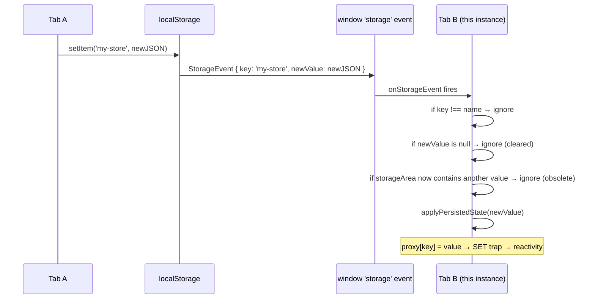
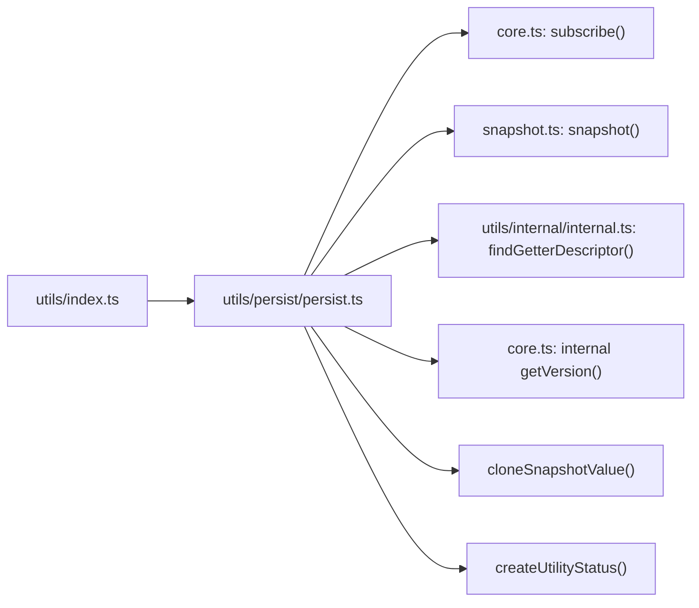

# Persist Utility -- Architecture

Internal design documentation for the `persist()` utility in `@codebelt/classy-store/utils`.

## Design Principles

1. **Standalone utility, not middleware.** `persist` uses `subscribe` and `snapshot`, plus an internal version helper for stale-read protection. No changes to core reactivity or React hooks are needed.

2. **Tree-shakeable.** `persist` lives in a separate entry point (`@codebelt/classy-store/utils`). Bundlers that support tree shaking can omit unused utility code; verify the output for your build configuration.

3. **Storage-agnostic.** The `StorageAdapter` interface accepts sync (`localStorage`, `sessionStorage`) and async (`AsyncStorage`, `localForage`) implementations through the same type. `persist` handles both transparently via `await`.

4. **Class-aware defaults.** Default property selection excludes getters and functions. Explicit `properties` lists are used as supplied and should name writable data fields.

## How It Hooks Into the Existing Architecture

`persist` sits beside the existing three-layer architecture as an independent consumer:

```mermaid
flowchart LR
  subgraph existingCore ["Existing Core (unchanged)"]
    Mutation["store.prop = x"] --> Batch["queueMicrotask notify"]
    Batch --> Listeners["subscribe callbacks"]
  end

  subgraph persistLayer ["persist() utility"]
    Listeners --> Debounce["debounce timer"]
    Debounce --> Snap["snapshot(proxy)"]
    Snap --> Pick["pick properties"]
    Pick --> Serialize["per-property serialize"]
    Serialize --> Envelope["JSON.stringify envelope"]
    Envelope --> Queue["per-handle write/remove queue"]
    Queue --> Storage["storage.setItem()"]
  end

  subgraph hydration ["Hydration (init / cross-tab / manual)"]
    Read["storage.getItem()"] --> Parse["JSON.parse"]
    Parse --> Migrate["version check + migrate"]
    Migrate --> Deserialize["per-property deserialize"]
    Deserialize --> Merge["merge strategy"]
    Merge --> Apply["proxy[key] = value"]
    Apply --> Mutation
  end
```



The key insight: writing `proxy[key] = value` during hydration flows through the existing SET trap in `core.ts`, which handles child proxy cleanup, version bumping, and notification scheduling automatically. The persist utility doesn't need to know anything about the proxy internals.

## File Structure

```
src/
  index.ts                      # Existing barrel (unchanged)
  utils/
    index.ts                    # Barrel: persist, devtools, subscribeKey, withHistory
    persist/
      persist.ts                # Storage queue, hydration, and persistence logic
      persist.types.ts          # Public options, transforms, adapter, status, and handle
      persist.test.ts           # Tests with mock storage adapters
      persist.api.test.ts       # Public lifecycle and status behavior
      persist.concurrent.test.ts # Overlapping reads, writes, and disposal
      persist.errors.test.ts    # Error reporting and rejection policy
package.json                    # "./utils" export entry
tsdown.config.ts                # 'src/utils/index.ts' in entry array
```

## Internal State

Each `persist()` call creates a closure with the following internal state:

| Variable | Type | Purpose |
|---|---|---|
| `disposed` | `boolean` | Guards against writes after `dispose()` |
| `hydrating` | `boolean` | Suppresses auto-saves while applying restored state and flushing its notification |
| `debounceTimer` | `ReturnType<typeof setTimeout> \| null` | Active debounce timer (cancelled on save/clear/dispose or accepted hydration) |
| `storageQueue` | `Promise<void> \| undefined` | Orders this handle's writes/removals and lets reads wait for prior operations |
| `hydrationRequest` | `number` | Rejects read results superseded by newer requests or storage events |
| `clearedVersion` | `number \| undefined` | Suppresses a pre-clear mutation's pending batched auto-save |
| `hydratedFlag` | `boolean` | Synchronous hydration status |
| `expiredFlag` | `boolean` | Set to `true` when hydration encounters expired data |
| `lastError` | `PersistStatus['lastError']` | Latest reported failure; cleared after a successful operation |
| `resolveHydrated` | `() => void` | Resolves the `hydrated` promise |
| `resolvedProps` | `Array<{key, transform?}>` | Normalized property list with optional transforms |
| `transformMap` | `Map<string, PropertyTransform>` | Fast lookup from key to transform |
| `propKeys` | `string[]` | Flat list of property keys to persist |

Bookkeeping is per handle. Handles on the same store still observe each other's applied mutations, and handles using the same storage key can overwrite one another. Their queues do not coordinate with each other.

## Save Flow

Triggered by `subscribe(proxy, callback)` firing after each batched mutation:

```
1. subscribe callback fires
2. if disposed, applying hydration, or this version was cleared → return
3. if debounce > 0:
     cancel existing timer
     schedule new timer → goto step 4 after delay
   else:
     goto step 4 immediately
4. snapshot(proxy) → cached snapshot (with ordinary opaque-leaf semantics)
5. for each key in propKeys:
     read value from snapshot
     if transform exists → call transform.serialize(value)
     assign to state object
6. wrap in envelope: { version, state }
7. if expireIn is set → stamp expiresAt = Date.now() + expireIn
8. JSON.stringify(envelope)
9. enqueue storage.setItem(name, json) behind prior writes/removals
```

The serialized value is captured when requested. The first queued operation
starts immediately, so synchronous adapters keep their normal timing. Each
operation catches adapter errors and reports them through `onError`; a rejected
write does not prevent the next operation from starting. Cleanup skips operations
that have not started. This queue belongs to one handle, not the storage key globally.

### Property Resolution

On initialization, `resolveProperties()` determines which keys to persist:

- **If `properties` is provided:** each entry is either a string key (used as-is) or a `PropertyTransform` descriptor (key extracted, transform stored in `transformMap`).
- **If `properties` is omitted:** takes a snapshot of the store, iterates `Object.keys()`, and excludes:
  - **Getters:** detected via `findGetterDescriptor()` walking the prototype chain with `Object.getOwnPropertyDescriptor`.
  - **Methods:** detected via `typeof value === 'function'` on the proxy.

This resolution happens once at `persist()` call time, not on every save.

### Storage Envelope

Data is stored as a JSON string with a version wrapper:

```json
{
  "version": 1,
  "state": {
    "todos": [{"text": "Buy milk", "done": false}],
    "filter": "all"
  },
  "expiresAt": 1700000000000
}
```

The `version` field is always present (default `0`). The `state` field contains only the selected properties, post-serialization-transform. The `expiresAt` field is a Unix epoch timestamp (milliseconds) and is only present when `expireIn` is set. It is refreshed on every write. Envelopes without `expiresAt` are treated as "never expires".

## Restore Flow (Hydration)

Triggered in three scenarios:
1. **Auto-hydration on init** (unless `skipHydration: true`)
2. **Manual rehydrate** via `handle.rehydrate()`
3. **Cross-tab sync** via `window.storage` event

All three call the same `applyPersistedState(raw)` function:

Async reads first wait for prior writes/removals. They capture a request number
and the store version, and only apply their result if both are still current and
the handle remains active. A newer read/save/clear/storage event changes the
request number; a local edit changes the store version. Obsolete results and
read errors are ignored. Applying hydration suppresses echo writes until the
batched subscription notification has run, with cleanup in `finally`.

```
1. JSON.parse(raw) → envelope
2. Validate envelope shape (object with .state)
   if invalid → return silently (corrupted data)
3. if envelope.expiresAt exists AND Date.now() >= expiresAt:
     set expiredFlag = true
     if clearOnExpire → storage.removeItem(name)
     return (skip hydration)
4. if envelope.version !== options.version AND migrate exists:
     state = migrate(state, envelope.version)
5. for each stored state key:
     if transform exists → state[key] = transform.deserialize(state[key])
6. Build currentState from snapshot (only propKeys)
7. Apply merge strategy:
     'shallow': { ...currentState, ...persistedState }
     custom function: merge(persistedState, currentState)
8. for each key in propKeys:
     if key in mergedState → proxy[key] = cloneSnapshotValue(mergedState[key])
     (goes through SET trap → reactivity → batched notification)
9. Initial/manual read completion marks hydratedFlag and resolves hydrated.
   Storage-event application alone does not mark hydration settled.
```

### Merge Strategies

| Strategy | Behavior |
|---|---|
| `'shallow'` (default) | `{ ...current, ...persisted }` — stored keys overwrite, missing keys keep current values |
| Custom `fn` | `fn(persisted, current)` -- full control. Enables deep merge or selective overrides. |

The public merge option accepts `shallow` or a function. Shallow merging replaces each stored top-level property, including its nested value; use a custom function to combine nested data.

### Error Handling

- **Corrupted JSON** in storage (`JSON.parse` throws): reported as `parse` through `onError` and status, with no state changes.
- **Invalid envelope** (missing `.state` or not an object): detected by shape check, skipped silently.
- **Adapter read errors** during `storage.getItem()`: reported as `read` when the request is current. Exceptions from custom migration/merge/transform callbacks are reported as `parse`. Initial hydration settles after reporting; explicit `rehydrate()` rejects with the original error.

## Cross-Tab Sync

When `syncTabs: true` is set, the utility listens for the `window.storage` event:



Key properties of `window.storage`:
- For `localStorage`, fires in **other** same-origin tabs (not the tab that wrote). The hydration guard prevents echo writes and loops.
- Cross-tab delivery uses `localStorage`. `sessionStorage` events are limited to same-tab contexts sharing the area; async adapters do not emit these browser events.
- The event payload includes `key`, `oldValue`, `newValue`, and `storageArea`.

`syncTabs` defaults to `false`; enable it explicitly for localStorage-backed state.

## Cleanup

`handle.dispose()` performs these cleanup steps:

```
1. Set disposed = true (guards all future writes)
2. Cancel pending debounce timer (if any)
3. Call unsubscribe from store mutations (remove subscribe callback)
4. Remove window 'storage' event listener (if syncTabs was active)
5. Publish disposed status and clear status listeners
```

After `dispose()`:
- Store mutations no longer trigger writes to storage.
- Cross-tab changes to the storage key are ignored.
- `save()`, `clear()`, and `rehydrate()` reject without starting new work.
- Queued writes/removals that have not started are skipped. Already-issued adapter I/O can still finish.
- Pending read results/errors are ignored, and their promises settle when the reads finish.

## PersistHandle API

| Method/Property | Behavior |
|---|---|
| `dispose()` | Idempotent cleanup: cancel debounce and listeners, publish disposed status, ignore pending reads and skip unstarted writes. |
| `hydrated` | Resolves when a hydration attempt settles, including failure or a superseded read. Inspect `lastError` for reported failures. |
| `isHydrated` | Readonly getter; true after a hydration attempt settles. |
| `isExpired` | Readonly getter; true when hydration found expired data. Re-evaluated by `rehydrate()`. |
| `save()` | Cancel debounce, capture current state, and enqueue its write. |
| `clear()` | Cancel pending auto-saves and enqueue removal after earlier writes. |
| `rehydrate()` | Read after prior writes, apply if still current, and await expired-data removal when enabled. |
| `getSnapshot()` | Cached readonly `PersistStatus`: hydration, expiry, disposal, and latest error. |
| `getServerSnapshot()` | Initial status for server rendering and hydration. |
| `subscribe(listener)` | Synchronous status subscription; returns listener cleanup. |

Explicit operations reject with the original failure after reporting it through `onError` and status. Automatic operations catch reported failures at their background entry points. Decoding, transform, migration, and merge errors use the `parse` operation. The internal queue absorbs rejections so later writes still run. Calls on disposed handles reject; explicit queued operations cancelled by disposal also reject without invoking the adapter.

## Dependency Graph



`persist` has no React runtime dependency. Its public contracts live in `persist.types.ts` and are exported by `utils/index.ts`. Transform types use `Snapshot` from the public core `types.ts`. Runtime helpers include:
- `subscribe()` -- to listen for store mutations
- Internal `getVersion()` -- to reject stale reads and suppress pre-clear auto-saves
- `snapshot()` -- to read cached state for serialization
- `findGetterDescriptor()` -- to detect class getters during property resolution
- `createUtilityStatus()` -- to cache and publish utility status
- `cloneSnapshotValue()` -- to restore mutable values from snapshots

## Performance Characteristics

| Operation | Complexity | Notes |
|---|---|---|
| Property resolution | O(keys) | Once at init, not per-save |
| Save | Depends on state size and transforms | Snapshot work + selected-field traversal + JSON serialization + adapter I/O |
| Debounce scheduling | O(1) per notification | Timer reset; serialization and write happen when it fires |
| Hydration | Depends on payload and restored state | Parse + user callbacks + mutable cloning + assignments and notifications |
| Cross-tab sync | Same state-application costs as hydration | Uses the event payload, with a current-value check |
| `save()` | Same serialization costs as auto-save | Captures immediately, then waits for queued adapter work |
| `dispose()` | Depends on status listeners | Cancels timer/subscriptions and publishes final status |

## Design Decisions

### Why a function, not a decorator or middleware?

Decorators require class modifications and don't compose well with the existing `createClassyStore()` wrapping. Middleware requires an interception layer that doesn't exist in the architecture (the proxy IS the middleware). A standalone function that takes a proxy and returns a handle is the simplest, most composable API.

### Why per-property transforms instead of global serialize/deserialize?

A per-property transform can handle one value, such as a `Date`, while other fields keep their ordinary JSON representation. The property key determines the serializer and deserializer types.

### Why exclude getters automatically?

Class getters are derived/computed values that recompute from persisted data properties. Persisting a getter result would be redundant and risk restoring a stale value that contradicts the actual data. For example, if `get remaining()` returns 3 but the persisted `todos` array has 5 incomplete items, the restored getter value would be wrong until something triggers a recompute. By excluding getters, we persist only the inputs and let the outputs recompute naturally.

### Why a hydrated Promise instead of lifecycle hooks?

`hydrated` resolves once a hydration attempt settles, even if that attempt fails. Inspect `lastError` for reported errors. It stays resolved during later reads; await `rehydrate()` when waiting for a specific read or rejecting on failure matters. React components can observe changes with `usePersistStatus(handle)`.

### Why debounce instead of throttle?

Debounce waits for a quiet period after the last mutation. Throttle writes at regular intervals. For persistence, debounce is more appropriate: it coalesces bursts of mutations (like typing) into a single write, while throttle would write mid-burst with potentially incomplete state. `save()` provides the escape hatch for "write right now" scenarios.

| Group | What's covered |
|---|---|
| Basic round-trip | Save/restore, versioned envelope, getter exclusion, method exclusion |
| Properties option | Persist specific properties, restore only specified properties |
| Per-property transforms | Date round-trip, ReactiveMap round-trip |
| Debounce | Coalescing, save bypass |
| Version migration | Migration call, version match skip |
| Merge strategies | Shallow or custom function |
| skipHydration | No auto-hydrate, manual rehydrate, promise resolution |
| Dispose | Stop writes, cancel debounce |
| Save/clear/rehydrate | Immediate write, remove data, in-memory preservation, re-read |
| Hydration state | Promise instance, resolution timing |
| Async storage | Async write, async hydrate |
| Cross-tab sync | Correct key, wrong key, post-disposal, disabled |
| expireIn / TTL | Normal hydration, expired skip, clearOnExpire, default leave-in-storage, cross-tab reject, no-expiresAt envelope, TTL reset on write, rehydrate re-check |
| Edge cases | Empty storage, corrupted JSON, invalid envelope, no-storage error, multiple persists |
